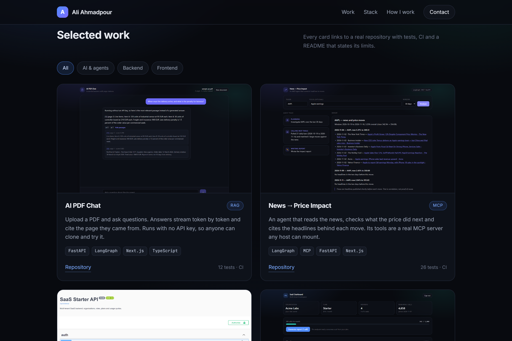

# Portfolio site

My personal site: four working projects, the stack behind them, and a way to get in touch.



## What is in here

```
index.html    one page, semantic markup
styles.css    hand-written CSS: custom properties, fluid type, grid, media queries
app.js        vanilla JavaScript: sticky header, mobile nav, project filter, scroll reveal
assets/       screenshots, captured from the running projects
docs/         images used in this README
```

No framework, no bundler, no dependencies, no build step. Open `index.html` and it
works. That is a deliberate choice: it keeps the site instant, and it is evidence
for the plain HTML/CSS/JS claim on the page itself.

## The JavaScript

Roughly 80 lines in [`app.js`](app.js), and each block does one thing:

1. **Sticky header** — toggles a border once the page has scrolled.
2. **Mobile navigation** — button with `aria-expanded`, closes on link click.
3. **Project filter** — reads `data-tags` off each card; no re-render, no state library.
4. **Scroll reveal** — `IntersectionObserver`, unobserves after firing, and the CSS
   disables all of it under `prefers-reduced-motion`.
5. **Footer year** — so it never goes stale.

## Running it

```bash
python -m http.server 3003
```

Then open <http://127.0.0.1:3003>.

## Deploying

The directory is already a static site, so any host works. GitHub Pages:

1. Push this repository to GitHub.
2. **Settings → Pages → Source: Deploy from a branch → main / (root)**.
3. The site appears at `https://<user>.github.io/portfolio-site/`.

To serve it at the root of your domain instead, name the repository
`<user>.github.io`.

## Accessibility notes

- Skip link, landmarks, and a single `h1`.
- The filter is a set of real buttons with `aria-pressed`-style active state, not divs.
- All images have alt text; decorative glow is `aria-hidden`.
- Motion is opt-out via `prefers-reduced-motion`.

## Licence

MIT
